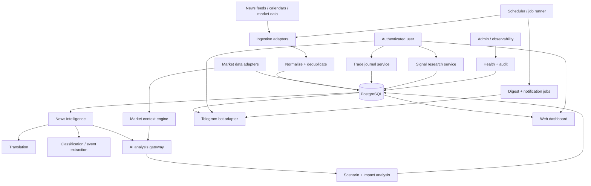

# GoldNewsBot — Target Architecture

**Status:** Initial design baseline (proposal, not production implementation)  
**Version:** 0.1  
**Scope:** News intelligence, Telegram assistant, personal trading journal, risk-aware signal research, and web dashboard.

## 1. Product vision

GoldNewsBot evolves from a scheduled news publisher into a modular market-intelligence workspace. It must keep the existing news delivery reliable while adding user-specific features behind independent modules and feature flags.

Primary product areas:
1. **News desk:** source ingestion, deduplication, translation, classification, breaking-news detection, archive, and scheduled digests.
2. **Market intelligence:** fundamental context, cross-market relationships, scenario analysis, and source-linked AI commentary.
3. **Personal assistant:** Telegram commands and conversations, preferences, watchlists, reminders, and saved research.
4. **Trading journal:** manual trade capture, position sizing, execution notes, screenshots/attachments later, and realized/unrealized P&L.
5. **Research signals:** explainable setups, entry/stop/target scenarios, risk checks, expiry, and outcome tracking. No broker execution in the initial product.
6. **Dashboard:** private workspace for administration, news history, analytics, journal, and system health.

## 2. Architecture principles

- **Modular monolith first:** one Python codebase, explicit module boundaries, one deployable application initially. Avoid premature microservices.
- **Preserve current service:** existing news workflows remain operational during migration; new components are introduced alongside them.
- **PostgreSQL as source of truth:** JSON files become import/export/backup artifacts, not concurrent production databases.
- **Ports and adapters:** Telegram, news providers, AI vendors, market-data sources, and storage are replaceable adapters.
- **AI is advisory:** preserve citations, timestamps, confidence/uncertainty, assumptions, and a clear distinction between sourced facts and generated interpretation.
- **Human control:** trades are manually recorded; signals are research outputs, not automatic orders.
- **Secure by default:** secrets outside Git, least-privilege access, per-user data isolation, audit trails, and explicit authorization.
- **Observable and recoverable:** structured logs, health checks, retries, idempotency, backups, and tested restore procedures.
- **UTC internally:** store timestamps in UTC; render user-facing time in Asia/Kabul by default, with per-user timezone preference later.

## 3. Target component map



## 4. Logical modules and ownership

| Module | Owns | Must not own |
|---|---|---|
| `ingestion` | Provider polling, feed parsing, normalization, deduplication | Telegram formatting, trade records |
| `news` | News lifecycle, event taxonomy, archive, source attribution | External provider credentials |
| `translation` | Language detection and translation adapter | News persistence policy |
| `analysis` | Rule-based and AI-assisted market interpretation | Publishing directly to Telegram |
| `market_data` | Quotes, calendars, instrument metadata, market sessions | User trading decisions |
| `assistant` | Conversation orchestration, user preferences, command routing | Direct SQL from handlers |
| `journal` | Trades, fills/events, fees, risk and P&L calculations | Broker execution |
| `signals` | Research setup lifecycle, validation, expiry, outcomes | Auto-trading / order placement |
| `notifications` | Templates, delivery queue, retries, preferences | Business-rule calculations |
| `dashboard` | Authenticated read/write application interface | Direct access to secrets |
| `identity` | Users, roles, authorization, subscriptions | Telegram transport details |
| `platform` | Config, database, migrations, logging, health, audit | Domain-specific decisions |

All modules expose service interfaces. Telegram handlers and dashboard routes call application services; they do not implement domain rules or issue ad hoc database queries.

## 5. Proposed repository layout

The current root-level Python files should be migrated incrementally, not moved in one risky change.

```text
GoldNewsBot/
├── app/
│   ├── main.py
│   ├── config.py
│   ├── api/                 # health and dashboard API
│   ├── platform/            # database, logging, security, jobs
│   ├── identity/            # users, roles, access control
│   ├── ingestion/           # RSS, calendar and provider adapters
│   ├── news/                # news entities, archive, classification
│   ├── translation/
│   ├── analysis/            # rules, AI gateway, scenarios
│   ├── market_data/
│   ├── assistant/           # Telegram orchestration
│   ├── journal/
│   ├── signals/
│   ├── notifications/
│   └── dashboard/
├── migrations/              # Alembic revisions
├── tests/
│   ├── unit/
│   ├── integration/
│   └── acceptance/
├── docs/
├── scripts/                 # import, backup, restore, maintenance
├── dashboard/               # existing frontend, migrated gradually
├── .github/workflows/
├── .env.example
├── requirements.txt
└── README.md
```

## 6. Main data flows

### News pipeline
1. Scheduler starts a source-specific ingestion job.
2. Adapter fetches source data with timeouts and bounded retries.
3. Normalizer creates a canonical item and retains original URL, source, publication time, and language.
4. Deduplication uses canonical URL and content fingerprint.
5. Item is persisted before downstream analysis.
6. Translation/classification/analysis jobs run independently and record their status.
7. Notification policy decides whether to send breaking news, digest, or no message.
8. Delivery result and provider message ID are recorded for retry safety and audit.

### AI analysis pipeline
1. Load canonical news and relevant market context.
2. Build a bounded prompt from trusted structured data.
3. Request a structured response from the configured AI provider.
4. Validate schema and required source references.
5. Persist model/provider/version, prompt template version, timestamp, output, confidence and limitations.
6. Render fact, interpretation, scenarios, and risk caveat separately.
7. Never allow model output to directly trigger orders.

### Trade journal pipeline
1. User submits a manual trade or edit.
2. Validate instrument, direction, timestamps, quantities, prices, fees, and account ownership.
3. Store immutable trade events/fills; derive position and P&L from events.
4. Calculate realized P&L using a documented accounting method and preserve currency/contract metadata.
5. Show analytics only for the requesting authorized user.

### Signal research pipeline
1. Strategy module emits a candidate setup with instrument, timeframe, entry zone, invalidation, targets, expiry, and rationale.
2. Risk validator checks configured limits and data freshness.
3. Setup is persisted with strategy/version and status.
4. Telegram/dashboard publishes only if enabled and approved by policy.
5. Expired, invalidated, and completed setups are tracked for honest performance reporting.

## 7. Runtime and deployment target

**Initial target:** a single managed Python application/worker with PostgreSQL, plus the existing static dashboard. Keep GitHub Actions for CI, scheduled maintenance, and controlled operations—not as the long-term always-on conversational runtime.

Deployment environments:
- **Local:** developer machine, isolated test database, mock Telegram/AI adapters.
- **Staging:** separate bot token, separate Telegram test channel, separate database, synthetic or limited data.
- **Production:** production secrets, managed PostgreSQL with backups, restricted admin access, monitoring and rollback.

Do not select a hosting vendor until uptime, budget, region, outbound network, persistent storage, and deployment requirements are confirmed. Redis/queue infrastructure is optional until workload justifies it; start with a PostgreSQL-backed job/outbox pattern or a single worker.

## 8. Security and privacy baseline

- Store Telegram, AI, market-data, and database credentials only in environment secrets/secret manager.
- Commit only placeholder values in `.env.example`; ignore real `.env` files.
- Validate Telegram user identity and authorize every private command/action.
- Enforce ownership filters at service/repository boundaries; never trust a user-supplied user ID.
- Separate admin, operator, and ordinary user permissions.
- Use parameterized SQL/ORM, input validation, output encoding, request limits, and timeouts.
- Treat RSS content and AI output as untrusted data; do not execute instructions embedded in news.
- Redact secrets and private trade details from logs.
- Rate-limit expensive AI calls and user-facing commands.
- Record security-sensitive actions in an audit log.
- Define data export/deletion and retention rules before opening multi-user registration.
- No public user registration until authentication, authorization, and isolation tests pass.

## 9. Reliability and operations

- Idempotency keys for ingestion and notifications.
- Bounded retries with exponential backoff and dead-letter state for repeated failures.
- Separate source-health, worker-health, database-health, and Telegram-delivery metrics.
- Liveness and readiness checks.
- Structured logs with correlation IDs; no secrets or full private payloads.
- Daily database backups, retention policy, and scheduled restore tests.
- Schema migrations are versioned and run as a controlled deployment step.
- Feature flags for AI analysis, journal, signals, public access, and dashboard modules.
- Rollback plan for every database and runtime release.

## 10. Non-goals for the first release

- Automatic broker execution or copy trading.
- Guaranteed profitable signals or predictive certainty.
- Unmoderated public chat/registration.
- Microservices/Kubernetes before scale requires them.
- Replacing current JSON history before backup, import validation, reconciliation, and rollback are proven.

## 11. Architecture acceptance criteria

- Existing news publishing remains operational during staged migration.
- Every news item can be traced to its original source and publication time.
- Re-running ingestion does not create duplicate news or duplicate notifications.
- A Telegram user cannot read or modify another user's journal.
- AI outputs are stored with model/version and source context and are visibly advisory.
- P&L calculations have documented formulas and deterministic tests.
- Signal records have expiry and invalidation states and cannot place broker orders.
- Database backup can be restored in a documented test.
- Staging uses isolated credentials and data.
- CI, security checks, migration checks, and unit/integration tests pass before production deployment.
